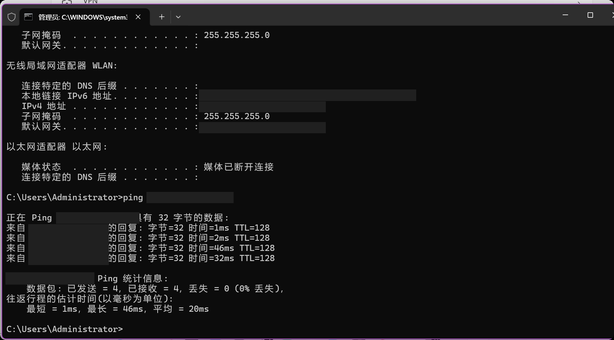
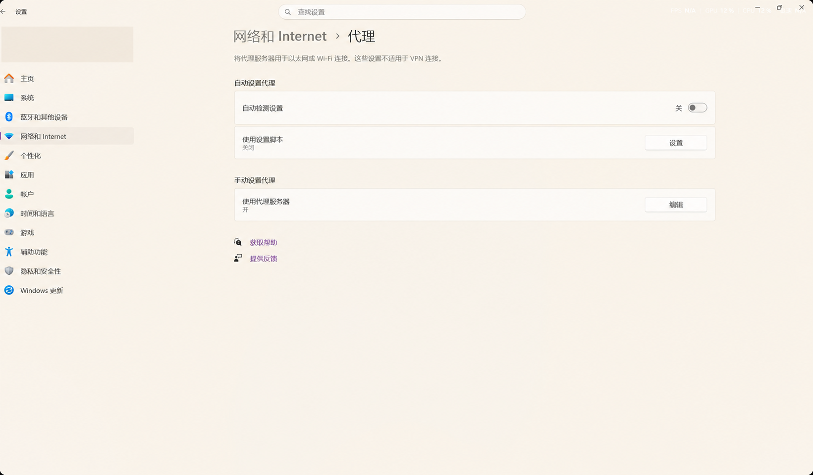

> 隐私说明：截图中的真实网络地址已遮盖，文中的地址统一为演示用地址，不对应本机实际配置；ping 结果与故障处理过程保留。

# Wi-Fi 已连接、局域网能 ping，网页和微信却打不开：一次代理设置排查

电脑已经连接 WLAN，能 ping 通局域网里的另一台机器，同一个网络里的其他电脑也能正常上网，但我的电脑打不开任何网页，微信等应用也无法联网。最后，关闭 Windows 设置中的“使用代理服务器”，访问恢复了正常。

这次经历让我重新理解了一个容易混淆的地方：**连接上 Wi-Fi、能 ping 通一台机器、能解析域名和能正常打开网页，分别说明了不同的事情。** 排查时把它们当成同一项测试，就很容易在错误的方向上反复折腾。

## 一、先把当时的现象记录清楚

这次已经确认的情况是：

- 电脑连接了 WLAN。
- 局域网里的其他机器可以正常上网。
- 我的电脑能 ping 通 `192.168.10.20`。
- 所有网页都打不开，微信等应用也无法联网。
- Windows 手动代理处于开启状态。
- 关闭“使用代理服务器”后，访问恢复。

下面是当时的 IP 配置与 ping 结果：



截图确认无线网卡已有 IPv4 配置、局域网 ping 收到回复。下面用示例地址说明它们的关系，不对应截图的原始网络地址：

| 项目 | 当时的值 | 能说明什么 |
| --- | --- | --- |
| WLAN IPv4 地址 | `192.168.10.10` | 无线网卡已经有一个局域网 IPv4 地址 |
| 子网掩码 | `255.255.255.0`，即 `/24` | 本机与目标 `192.168.10.20` 属于同一个 IPv4 子网 |
| 默认网关 | `192.168.10.1` | 配置了访问其他网络时通常使用的下一跳；配置存在不等于它已通过测试 |
| ping 目标 | `192.168.10.20` | 测试的是这台局域网主机，而不是公网网站 |
| 收发结果 | 发送 4 次、接收 4 次、丢失 0 次 | 这一次 ICMP 测试收到了全部回复 |

以太网网卡显示“媒体已断开连接”，不能据此判断整台电脑断网，因为这次使用的是 WLAN。截图中的 `fe80::` 地址是 IPv6 链路本地地址，也不能用来证明已经具备公网 IPv6 访问能力。

**当时并没有保存 DNS 查询、代理地址、代理端口或抓包结果。** 后文的检查命令是遇到类似问题时可以使用的方法，不是这次已经执行过的测试。

## 二、为什么 ping 正常，网页仍然打不开？

Windows 的 `ping` 通过发送 ICMP Echo Request、接收 Echo Reply，检查到目标的 IP 层连通性。它不会模拟一次浏览器网页请求，也不会替你验证 HTTP 代理。[Microsoft：ping 命令](https://learn.microsoft.com/en-us/windows-server/administration/windows-commands/ping)

当时执行的是对局域网 IP 的 ping。将实际地址替换为示例地址后，可以写成：

```cmd
ping 192.168.10.20
```

目标已经是一个 IP 地址，因此这个命令不需要先把网站域名解析成 IP。成功的结果不能证明 DNS 正常；它也没有验证公网出口、网站的 TCP 443 端口、TLS 握手或 HTTP 响应。

而且，这个目标与本机处于同一子网。正常情况下，IPv4 通信会先通过 ARP 获得本地目标或下一跳的链路层地址，再进行本地传输，并不需要沿着访问公网网站的路径经过默认网关。ARP 的职责是地址映射，不是网页访问。[RFC 826：ARP](https://www.rfc-editor.org/rfc/rfc826.html)

因此，下面两条路径可以同时出现完全不同的结果：

```text
局域网 ping：本机 → 局域网目标 → 收到 ICMP 回复

使用代理的网页访问：本机 → 配置的代理 → 目标网站
```

第一条路径正常，并不保证第二条路径上的代理也正常。反过来，一些服务器不回应 ping，但它们的 HTTPS 服务仍然可用，也不能仅凭 ping 失败判定网站宕机。

## 三、这次真正有效的修改：关闭手动代理

我在 Windows 的“设置 → 网络和 Internet → 代理”中，发现“手动设置代理”下面的“使用代理服务器”处于开启状态。



图中保留的是**修改前的开启状态**，左上角账户信息已做隐私遮盖。这里的“开”是本次排查的关键线索；截图没有展示具体的代理服务器地址与端口。

我的处理步骤是：

1. 打开 Windows 设置，进入“网络和 Internet → 代理”。
2. 在“手动设置代理”中，点击“使用代理服务器”旁的“编辑”。
3. 将“使用代理服务器”关闭，并保存设置。
4. 重新访问之前打不开的网页，并重新尝试微信等应用的联网操作。

也可以按 `Win + R`，输入下面的设置页面地址，快速进入代理页面：

```text
ms-settings:network-proxy
```

Windows 支持手动代理、自动检测及设置脚本等方式；Wi-Fi 与以太网连接都可能使用代理。不同版本的界面可能显示“设置”或“编辑”。这次有效的操作是关闭手动代理，不需要为了照搬截图而修改其他开关。公司或学校如果要求通过指定代理访问网络，应核对其配置与可用性，而不是把关闭代理当作通用要求。[Microsoft：在 Windows 中使用代理服务器](https://support.microsoft.com/en-us/windows/experience/connectivity-networking/use-a-proxy-server-in-windows)

## 四、代理为什么会让一台已经连上 Wi-Fi 的电脑无法访问网站？

代理改变的是一部分应用请求的访问路径。以常见的显式 HTTP 代理为例，客户端先连接代理，再由代理参与访问目标。对于 HTTPS，常见方式是通过 `CONNECT` 请求建立隧道，随后在隧道内进行面向目标网站的 TLS 通信；这不意味着代理天然可以读取 HTTPS 的明文内容。[RFC 9110：代理及 CONNECT 隧道](https://www.rfc-editor.org/rfc/rfc9110.html#section-9.3.6)

如果应用遵循的代理配置指向一个不可用的中间节点，那么电脑的无线连接和局域网通信即使正常，应用请求也可能在这个节点处失败。下面都是合理的排查方向：

- 配置指向本机代理服务，但相关软件没有启动或已经退出。
- 代理地址、端口与当前实际服务不匹配。
- 远端代理不可达、拒绝连接，或者需要认证。
- 代理服务还在运行，但它的上游连接失败。
- 软件退出后，系统代理配置没有被恢复。

**这些是可能机制，不是已经确认的本次根因细节。** 关闭手动代理后恢复，说明这项配置及其对应的访问路径与故障高度相关；没有代理地址、端口、服务状态和连接日志，就不能进一步断言“某个软件退出后留下了某个端口”。

微信与网页一同恢复，也不意味着微信的所有通信都一定使用 Windows 手动 HTTP 代理。不同应用、网络库和版本可能采用不同的代理设置；仅凭同时失败、同时恢复，不能还原每个应用的内部连接过程。

## 五、把 DNS、IP、传输协议和网页访问放在各自的位置

### 1. IP 地址和默认网关：要把数据送到哪里？

IP 地址用于标识网络中的接口或通信端点。子网掩码帮助 IPv4 主机判断目标是否属于本地子网；对于不在本地子网的目标，主机会根据路由表选择下一跳，默认网关是其中一种常见选择。

这次的 `192.168.10.10/24` 与 `192.168.10.20` 属于同一子网，所以“能访问这台局域网机器”和“能通过网关访问公网”是两项不同的检查。同网其他机器能上网，会让“路由器或外网整体故障”的可能性降低，但不能排除只针对本机的配置、策略或连接问题。

### 2. DNS：域名对应什么地址？

访问网站时，我们通常输入域名，而不是 IP。DNS 提供域名相关记录的查询；常见的 A 记录对应 IPv4 地址，AAAA 记录对应 IPv6 地址。解析过程可能利用缓存，递归解析器也可能继续向其他 DNS 服务器查询。DNS 找到地址后，应用还需要建立连接和交换数据，因此“解析成功”并不等于“网页一定能打开”。[RFC 1034：DNS 的概念与解析机制](https://www.rfc-editor.org/rfc/rfc1034.html)

传统 DNS 可以使用 UDP 或 TCP 53 端口，不能简单理解成“DNS 只用 UDP”。浏览器也可能采用 DNS over HTTPS，通过 HTTPS 传输 DNS 查询。于是，命令行与浏览器的解析结果有时来自不同路径。[RFC 1035：DNS 传输](https://www.rfc-editor.org/rfc/rfc1035.html#section-4.2)、[RFC 8484：DNS over HTTPS](https://www.rfc-editor.org/rfc/rfc8484.html)

使用代理时，也不能固定套用“本机先解析目标域名，再连接目标 IP”的顺序：目标域名可能交给代理解析；如果代理地址本身是域名，本机又可能需要先解析代理的地址。应结合代理类型和应用行为判断。[RFC 9110：连接与代理选择](https://www.rfc-editor.org/rfc/rfc9110.html#section-4.3)

### 3. ICMP、TCP、UDP：它们检查或承载的内容不同

| 协议或机制 | 主要作用 | 与这次排查的关系 |
| --- | --- | --- |
| ICMP | 控制消息与诊断，例如 ping 的请求和回复 | ping 成功不能代表 HTTP 代理或网页访问正常 |
| TCP | 面向连接的可靠字节流传输 | 可以单独检查某台服务器的 TCP 端口是否能建立连接 |
| UDP | 数据报传输，本身不提供 TCP 式的可靠有序字节流 | 不能由一次 TCP 测试推断所有 UDP 通信也正常 |
| TLS | 为通信提供加密、完整性保护，并按配置验证对端身份 | TCP 连接成功后，TLS 握手仍可能失败 |
| HTTP / HTTPS | 应用请求与响应；HTTPS 使用安全连接 | 需要实际请求验证，不能由局域网 ping 代替 |

这里可以用常见的 HTTP/1.1 或 HTTP/2 over TLS 理解 HTTPS 的 TCP 访问路径，但不能说“所有 HTTPS 都使用 TCP”：HTTP/3 使用 QUIC，QUIC 的底层基于 UDP。[RFC 9114：HTTP/3](https://www.rfc-editor.org/rfc/rfc9114.html)

协议名分别对应不同职责。IP 层可达、端口可连接、TLS 校验成功、HTTP 返回正常内容，不能互相替代。

## 六、下次遇到类似问题，我会怎样逐步排查？

以下命令是后续排查建议，**不是这次截图之外的历史测试结果**。目标地址应换成自己有权访问、并且平时可以访问的主机或网站；不要把某一个测试目标的失败当成整个互联网不可用。

### 第一步：确认影响范围，查看本机配置

先比较同网络里的其他设备。如果只有一台机器异常，优先查看本机配置；如果多台机器都异常，再进一步检查网关、网络出口与服务状态。

```cmd
ipconfig /all
```

重点看实际使用的网卡、IP 地址、默认网关和 DNS 服务器。不要只盯着一张没有使用的有线网卡，也不要看到有 IP 地址就结束排查。

### 第二步：分别测试局域网目标与网关

下面使用脱敏后的示例地址，实际排查时应替换为自己的局域网目标和网关：

```cmd
ping 192.168.10.20
ping 192.168.10.1
```

两项测试分别检查局域网目标和网关是否回应 ICMP。失败时还要考虑对端是否限制 ICMP；成功也不代表公网与网页服务已经验证完毕。

### 第三步：单独检查 DNS

```cmd
nslookup www.microsoft.com
```

`nslookup` 用于查询 DNS 信息。观察查询是否成功、使用了哪个 DNS 服务器、返回了哪些记录。它不能代替浏览器发起 HTTPS 请求，也不一定代表浏览器启用安全 DNS 时的完整解析路径。[Microsoft：nslookup](https://learn.microsoft.com/en-us/windows-server/administration/windows-commands/nslookup)

只有证据指向解析异常时，才进一步核对 DNS 配置和缓存。不要在 DNS 已能返回合理结果、故障实际位于代理路径时，反复换 DNS，希望它能修好代理连接。

### 第四步：区分 TCP 端口连接与实际网页请求

在 PowerShell 中检查一个常用 HTTPS 目标的 TCP 443 端口：

```powershell
Test-NetConnection www.microsoft.com -Port 443
```

重点看 `TcpTestSucceeded`。该命令能提供解析和连接诊断，但不是浏览器通过 HTTP 代理访问网站的测试，也没有验证证书、HTTP 内容或登录过程。`PingSucceeded` 与 `TcpTestSucceeded` 是不同结果，不要混在一起。[Microsoft：Test-NetConnection](https://learn.microsoft.com/en-us/powershell/module/nettcpip/test-netconnection)

如系统提供 curl，还可以实际发起一次绕过显式代理的 HTTPS 请求：

```powershell
curl.exe --noproxy "*" --connect-timeout 10 --max-time 20 -I https://www.microsoft.com
```

这里明确写 `curl.exe`，避免部分 PowerShell 环境把 `curl` 解释成其他命令；`--noproxy "*"` 要求 curl 不使用显式代理。这个比较仍不能绕过 VPN 路由、透明代理或网络防火墙。`-I` 发出 HEAD 请求，只查看响应头，不能代替完整页面功能验证。[curl 官方手册](https://curl.se/docs/manpage.html)

如果同一个目标在直连测试中成功、应用经过代理时失败，代理配置或代理服务就是更有针对性的检查对象。

### 第五步：核对应用实际使用的代理设置

先看 Windows 代理页面，再看故障应用自己的网络设置。高级排查时，可只读查看 WinHTTP 配置：

```cmd
netsh winhttp show proxy
```

这个命令查看的是 **WinHTTP 的代理配置**，不应当成所有应用代理设置的统一答案。输出“直接访问”也不能单独证明 Windows 设置页面、浏览器、环境变量或应用内代理都已关闭；Windows 中不同应用栈可能采用不同的配置方式。[Microsoft：netsh winhttp](https://learn.microsoft.com/en-us/windows-server/administration/windows-commands/netsh-winhttp)、[Microsoft：代理服务器配置方式](https://learn.microsoft.com/en-us/troubleshoot/windows-server/networking/configure-proxy-server-settings)

若当前访问不需要代理，记录现有配置后关闭手动代理并复测。若需要代理，则确认代理服务是否运行、地址与端口是否正确，以及它的上游是否可用。任何端口测试都应使用实际配置，不能直接照搬网上的示例端口。

### 第六步：验证恢复，而不是只看网络图标

完成修改后，重新访问之前失败的网页，并测试微信等原本失败的应用。如果只有部分应用恢复，继续检查该应用自己的代理、会话状态或错误提示；如果设置被自动重新打开，再排查相关代理软件、启动项或组织策略。

## 七、这次经历留下的排查习惯

这次最有价值的线索，是局域网 ping 正常、同网其他设备正常，但本机所有网页和微信等应用都无法联网。关闭手动代理后恢复，让问题范围收敛到了本机的代理配置及访问路径。

以后再遇到“Wi-Fi 明明连着，却上不了网”，我会先问：**失败的是局域网通信、域名解析、目标端口连接，还是应用实际使用的访问路径？** 每个检查回答一个具体问题，再根据结果继续往下走。这样比直接更换 DNS、重置网络或重装网卡驱动更容易找到原因。