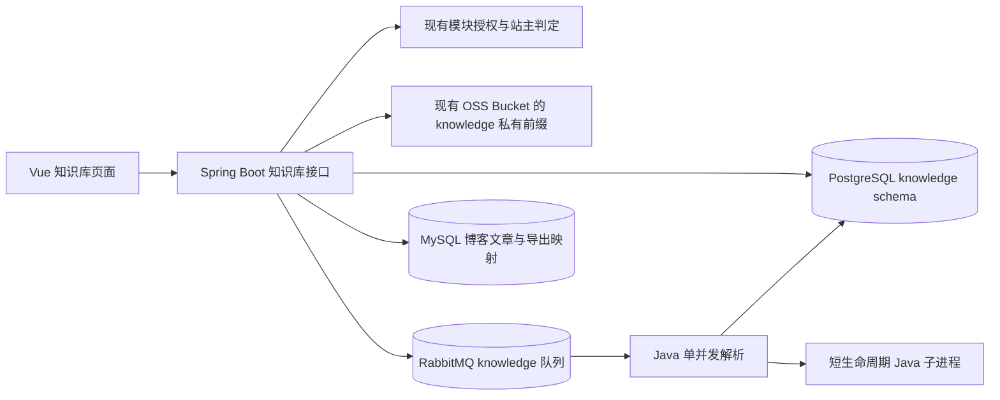
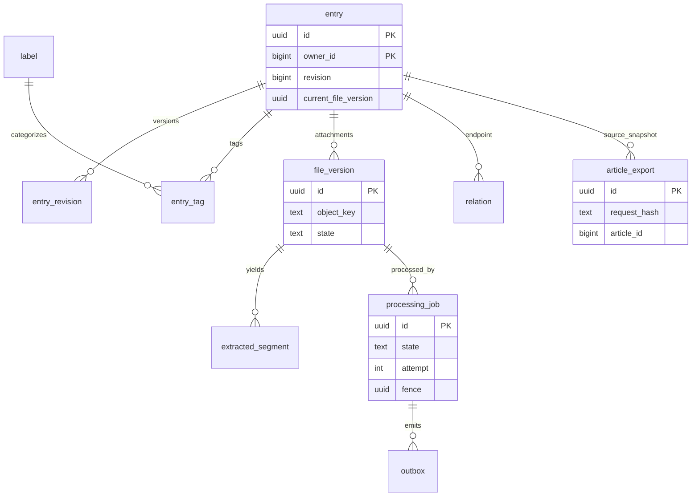
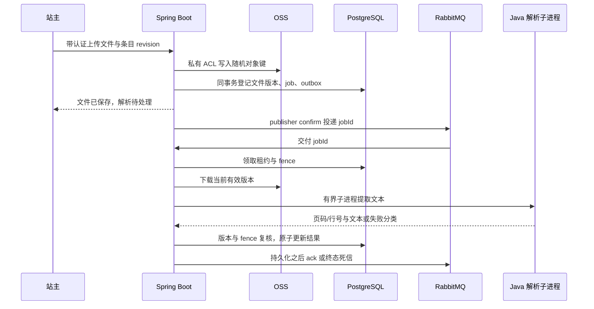
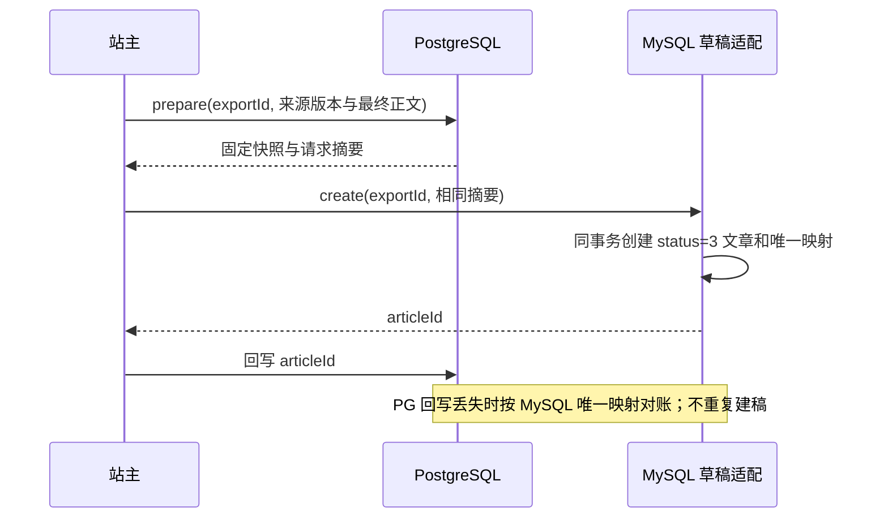

# 知识库：设计、演示与运维

此文档描述首版知识库。它把积累中的笔记和资料与正式博客文章分开，形成“记录 → 检索 → 手工关联 → 整理为文章草稿”的闭环。知识库由配置的站主维护，其他人按现有前台模块权限阅读。首版没有模型调用、向量搜索、OCR、网页抓取或自动写文章；日记数据不进入知识库。

## 毕业设计演示路线

1. 在后台“角色管理 → 前台模块访问”展示 `knowledge` 默认受限。站主在 `/admin/knowledge` 管理条目；博客前台 `/knowledge` 对所有获准访问的人（包括站主）只提供阅读、搜索、关系图和下载。匿名访问只能看到外框；给演示读者授权后，他仍不能使用后台写入接口。
2. 创建一条 NOTE 和一个 CONCEPT，添加分类与标签，修改 NOTE 并查看历史；用旧 revision 保存同一条目应得到冲突，原正文不丢。删除、回收、恢复展示软删与版本保留。
3. 上传一份不含私人内容的合成 PDF 或 UTF-8 文本。观察 QUEUED → RUNNING → READY，查看提取页码或行号；用中文词检索，展示标题、标签和正文/片段的排序及定位。原文件经鉴权下载，不出现公开 OSS 地址。
4. 手工建立 EXPLAINS、DEPENDS_ON、REFERENCES、RELATED_TO 关系，分别在局部图与键盘可用的列表中查看。撤销读者权限后，刷新搜索、关系和下载均应拒绝，已下载到读者设备的副本不受远程撤权控制。
5. 选最多 10 个固定版本来源，手工编排草稿正文，选择有效分类、标签与封面，确认创建未发布草稿。重复提交相同 exportId 应返回同一文章；前往原后台编辑，知识库来源后续修改不会覆盖草稿。
6. 展示失败路径：扫描 PDF 为 NEEDS_OCR；可重试解析失败至多三次后为 FAILED；站主可停止或显式重试。关闭 `knowledge.enabled` 后原博客和日记仍可用，知识库数据不被删除。

演示资料应为合成内容，不使用私密日记、真实密码或未经授权的附件。生产演示中的上传、读者授权及撤权须由站主账号实际验收。

## 组件和数据边界

PG 的 `knowledge_runtime` 角色只访问 `knowledge` schema；表启用强制 RLS，服务端在每个事务设置 owner 上下文。博客账号、权限、正式文章继续使用 MySQL；日记使用独立的 PG schema/角色。知识库复用现有 OSS Bucket 与服务器密钥，但上传请求原子指定私有 ACL，仅通过鉴权后端读取原件。共用密钥仍具有较大的 Bucket 权限，属于已接受的运维风险。

`relation` 还可指向 MySQL 的公开文章，不在 PG 创建跨数据库外键；读取时实时检查文章状态与博客权限。`article_export` 的 PG 快照与 MySQL 的 `t_knowledge_article_export` 幂等映射也没有跨库事务，服务靠 exportId、请求摘要及对账恢复不确定结果。

## 关键时序

生产消息仍可能重复交付；PG job/fence 是真相来源。`knowledge.parse.v1` 保持声明与消费以排空旧消息，新增任务发往带独立死信路由的 `knowledge.parse.v2`。邮件队列不在这条路由中。解析重试最多三次，临时对象与过期租约由受限扫描恢复；错误不会把半成品分段标记为 READY。

## 页面与接口边界

后台动态菜单需要执行 `sql/knowledge-admin-menu.sql` 后才会出现“网站管理 → 知识库管理”。该菜单仅授予 ADMIN 角色作导航，服务端仍逐次核对 `knowledge.owner-user-id`，其他管理员不能维护。前台阅读组件不包含写入工具；后台组件使用后台登录令牌。两套页面共享原有知识库接口和数据，无需迁移 PG 条目。

所有接口位于 `/api/knowledge/`（应用内部路由为 `/knowledge/`）。`GET view/capabilities` 返回是否可读、可用及可管理；其余 `view/**` 每次实时检查模块权限，`manage/**` 仅站主。主要接口包括 `view/entries/search`、`view/entries/{id}`、`view/search`、`view/relations/graph`、`view/files/{entryId}/{version}/content`；写入包括 `manage/entries`、`manage/entries/{id}/files`、`manage/relations` 和 `manage/exports/{prepare,create}`。原文件 API 只接受条目 ID 与版本，不接受任意 OSS 键。完整请求 DTO、限制和状态以 OpenSpec 变更 `add-knowledge-library-and-connections` 的规格与 `implementation-contract.md` 为准。

## 部署、监控与回退

- 部署先备份 PG `knowledge` schema、MySQL 文章及幂等映射、知识前缀对象清单和当前应用产物。迁移脚本为 `scripts/knowledge/000-roles.sql`、`001-knowledge.sql` 及相应 MySQL 迁移；必须用隔离数据库先演练，不能让测试默认连接生产。
- 手动加密元数据备份脚本为 `scripts/knowledge/backup-production.sh`。运行前显式提供 `KNOWLEDGE_PG_DATABASE`、`KNOWLEDGE_MYSQL_DATABASE`、权限为 0600 的 `KNOWLEDGE_MYSQL_DEFAULTS_FILE`、`KNOWLEDGE_BACKUP_RECIPIENT_FILE`；输出版本目录包含 PG custom dump、MySQL 映射 SQL、私有对象 CSV 清单和 SHA256 校验。不要把明文密钥放入命令行或提交到仓库。用 `python scripts/knowledge/verify-backup-restore.py` 在本机隔离容器重复恢复演练。该清单只记录数据库引用的对象，并不保存 OSS 文件字节；Bucket 级灾难恢复仍依赖独立对象副本或版本保护，不能只靠此脚本。
- 配置 `knowledge.owner-user-id`、独立 PG 运行角色/连接、现有 OSS 凭据和 Bucket。启动时先保持 `knowledge.enabled=false`；确认首页、博客、日记正常，再启用知识库。前端模块授权仍需在后台配置。文件能力须先通过真实私有对象的双域名匿名拒绝探针。
- 观察 JVM 与解析子进程 RSS、CPU、临时磁盘、PG 连接池、`processing_job` 中 RUNNING/RETRY_WAIT/FAILED、Rabbit v1/v2/dead 队列积压、OSS orphan 清理和 MySQL 导出映射。4 核/4 GiB/40 GiB 的机器保持解析单并发，不通过加常驻服务解决性能问题。
- 回退先关闭 `knowledge.enabled` 停止新上传与消费，再回滚应用产物；不要删除 `knowledge` schema、MySQL 映射、OSS 私有对象或待处理消息。恢复时先核对队列与 PG 任务，再重新启用。回退公开访问策略需在后台按权限撤回，关闭功能不等于物理删除已有资料。
- 灾难恢复应先在隔离环境恢复加密备份并核对条目历史、文件清单、关系、文章映射、RLS 与角色，再执行任何生产恢复。实际演练结果和恢复时间必须另记，不能把这份操作说明当成已通过的恢复测试。

## 后续扩展点

语义检索可在独立迁移中给知识条目和当前有效文件片段建立向量；它必须复用实时授权与版本失效边界，不能直接把原件推送给云模型。自动关系或 AI 辅助成文也应以站主明确触发、可核对来源和人工发布为前提。本版不含这些能力。
