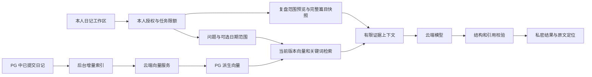

## Context

用户已选择“RAG 检索问答＋手动 AI 复盘”，并已允许云端模型分析日记。第一阶段已上线：Vue/Pinia/Element Plus 日记工作区、Spring Boot 4/Java 17、本人授权、独立 PG JDBC、小连接池、版本化原文和历史、行级隔离及加密备份。原文允许一篇跨多天，内容时间范围和创建时间分离，不能假定每天都有一篇记录。

生产 PG16.15 仅监听本机，MemoryHigh=384 MiB、MemoryMax=512 MiB，应用池最多 3 个连接，机器总内存约 4 GB。现有 MySQL、Java、Redis 等仍需正常运行。第一阶段迁移 `001-private-diary.sql` 对整个 `diary` schema 的表结构计算指纹；在其中随意新增 AI 表会破坏旧迁移重复校验。运行角色也不能拥有表、加入其他角色或取得 BYPASSRLS。

本次只创建规划。当前 GitNexus 索引落后 HEAD，规划依据已通过源码复核的日记契约和生产记录；图谱搜索未证明旧 ChatGpt/MySQL 结构具备私密 RAG 能力，不能直接复用其存储。实施前刷新图谱、逐符号 impact，并保留现有代理、备份、OpenWiki 等无关改动。不将真实日记内容、人物、工作单位、凭据或模型回复写入规划、测试夹具和仓库。

## Goals / Non-Goals

**Goals:**
- 提问后找到当前日记中的相关证据，回答可以定位到原篇目、版本和原文片段。
- 手动选择篇目或时间范围，得到有覆盖说明、事实依据、不确定性和可执行建议的复盘。
- 编辑、删除、恢复、模型更换、重启和云端故障后，仍能诚实表达索引和结果状态，不影响原文可靠保存。
- 私密数据、费用和服务器资源有明确边界，有真实 PG、HTTP 故障、浏览器和备份恢复验证。

**Non-Goals:**
- 自动日报/周报、提醒、自动发消息、多轮聊天记忆、自动改写日记、联网搜索、模型工具执行。
- 诊断疾病、给出人格或道德分数、承诺模型绝对客观、把未记录事件视为没有发生。
- 本机部署大模型、GPU、独立向量库、Dify/LangChain/Spring AI 等新增编排系统、HNSW/IVFFlat 默认索引、MySQL 迁移。
- 扩展给其他注册用户或管理员、公开问答、分享链接、原文永久销毁、自动清理原文历史。

## Decisions

### 1. 两条有区别的数据路径

问答选择相关片段，标明只使用检索到的材料；范围复盘先在一致快照中选齐符合范围的当前篇目，再把完整正文提交模型。范围复盘首版不依赖向量索引就绪，也不以 Top-K 片段代替整段生活的记录。若全量篇幅超过预算，要求缩小范围，不静默截断、不用部分内容输出“全面总结”。对未保存草稿不发起分析。

### 2. 复用应用与 PG，隔离新增 schema

使用现有日记 PG DataSource/JDBC/事务和独立包下的服务，新增 `diary_ai` schema：

| 数据 | 用途与边界 |
| --- | --- |
| `embedding_profile` | 供应商标识、模型、维度、切分版本的不可变指纹；不存密钥 |
| `entry_index` | owner/entry/profile、目标与已发布 revision、状态、有限重试/续传进度 |
| `chunk` | entry、source_revision、profile、序号、Unicode 码点偏移、片段摘要、向量与发布状态 |
| `job` | owner/requestId 唯一、请求摘要、类型、范围/问题、快照、状态、租约和安全错误码 |
| `report` / `report_source` | 结构化结果、模型/提示版本、来源 entry/revision/偏移、原文引用和覆盖信息 |
| `usage_budget` | Asia/Shanghai 日期的调用预留、已尝试数量及供应商返回的 token 用量 |
| `schema_version` | AI 迁移版本与明确对象集合的校验信息 |

owner 外键/组合键不允许把其他 owner 的 entry、profile、job 或 report 组合在一起。所有含个人数据的 AI 表启用并 FORCE RLS，事务设置与第一阶段相同的 owner 上下文。表属于迁移角色，运行角色仅增加 AI 派生表所需 DML；原三表的权限、所有权及不可变历史不变。

扩展由数据库管理员显式安装到独立 `diary_vector` schema，并给运行角色必要的类型/函数使用权。SQL 明确限定向量类型、函数和距离运算符的 schema，不重新开放已撤销的 public schema 权限，不使用可被普通用户控制的 search_path。现有 extension 冲突时拒绝自动搬迁。

新增版本化 AI 迁移，不修改旧 `001` 指纹以“兼容”漂移。验收必须在新迁移之后再次通过原 `001` 结构复核。应用启动不安装扩展、不自动迁移，AI 关闭时不连接云端或检查扩展，原日记保存独立可用。

### 3. 云端服务配置与启用

增加独立的 `diary.ai.enabled=false`，不与 `diary.enabled` 合并。后端通过 Java 17 有界 HTTP 客户端实现小型 EmbeddingClient/GenerationClient；首个适配器按所选供应商实际支持的 OpenAI-compatible embeddings/chat JSON 契约实现，兼容性通过契约测试验证，不把“接口兼容”视为所有可选参数均支持。

外置配置分别指定可信 HTTPS endpoint、密钥引用、embedding 模型、维度、生成模型、上下文限制和调用限额；不同供应商允许使用独立密钥。生产供应商尚未选择，不预填付费模型或未知维度。配置缺失返回 AI 不可用，日记保持可用；UI 不提供任意 URL/密钥编辑。禁止跟随重定向、模型自带 URL 或用户参数选择服务地址；部署配置限定可信供应商并检查解析地址，防止 SSRF。密钥从后端发送到相应服务，不进入 prompt。

首次展示会发送哪些数据：建立索引会向 embedding 服务发送日记片段；问答还会发送问题与相关片段；复盘会发送选定范围的正文。用户已允许云端分析，产品通过本人手动“建立索引”启动首次回填，并记录自动增量索引已开启；可暂停。此后仅对变更版本增量处理。复盘和问答均只由本人按钮触发，没有定时分析。

上线前核实实际供应商的数据保留、训练使用、地域和删除政策并展示准确说明，不宣称“云端零留存”。测试默认使用虚构数据和受控 HTTP 夹具；真实模型验收显式 opt-in。

### 4. 分块、模型维度与索引一致性

仅索引已提交、未删除的当前 entry。优先按段落分块，目标 800 Unicode 码点、最大 1000、重叠至多 120；单段过长按码点安全切开。保存相对于原 body 的 start/end 码点偏移和 SHA256，标题作为独立上下文且长度计入预算。禁止把跨日篇目复制成每日多篇，或把历史版本默认加入检索。

profile 指纹覆盖供应商、模型、维度、预处理/分块版本。向量维度显式配置并在每次响应校验，必须为有限数值且非零范数。使用可存不同维度的 vector 列和每行维度 CHECK，加上 profile/维度组合外键；查询先物化筛选相同 owner、profile 和维度的候选，再执行距离运算，禁止混合维度求距离。更换 embedding 配置使旧 profile 不再参与检索，提示重建；不把旧向量重新贴上新模型标签。已生成且来源仍有效的报告可保留其原模型说明。

原文保存链路不增加云端调用或必须写成功的 AI outbox。启用同步后，以低频、有限扫描比较当前 entry.revision 与 entry_index；编辑/删除立即通过查询时的当前版本 JOIN 排除旧片段，不等后台处理。向量调用在数据库事务之外执行，返回后在短事务复核 entry/owner/revision/deleted 状态，再整体发布该篇完整 chunk 集合；迟到旧响应不覆盖新版本。分批生成的暂存片段不可检索，进度可续传。

索引每批至多 8 块，后台单并发，批次间优先处理本人问答/复盘。失败版本记为 failed/unknown，不因每次扫描无限重复付费请求；由本人明确重试，或新版本重新排队。删除使片段立即不可检索，并在清理循环删除派生片段及引用失效结果的正文；历史恢复生成新 revision 后重新索引。暂停阻止后续 embedding 调用，已发出的请求无法承诺撤回。

### 5. 先做小规模精确检索

首版采用 cosine 精确扫描，结合标题/正文关键词包含匹配，按两路排名融合和稳定顺序合并，初始取 8 个片段、每篇最多 2 个，避免长日记占满证据。沿用 owner/当前 revision/未删除/选定日期过滤；中文关键词不引入新的分词服务。相似度不是置信概率，不能把一个固定阈值宣称为普遍正确；每个真实 embedding profile 用虚构校准集确定最小相关阈值。

状态返回符合范围的当前篇数、已索引篇数和失败篇数。索引不完整时默认阻止生成并提示补建索引；用户可明确选择“基于已索引记录回答”，此时必须标出缺失范围。向量服务不可用时可以显示明确标注的普通关键词搜索结果，但不能冒充完整 RAG 回答。没有充分证据时返回“记录不足”，不为满足答案形式补造经历。

选择精确扫描是本次数据规模和内存约束下的工程决定，后续数据增长再评估近似索引。[pgvector 官方文档](https://github.com/pgvector/pgvector)说明其支持精确/近似检索及 cosine 距离；模型效果、阈值和性能仍需本项目实测。

### 6. 时间范围与完整复盘

复用 created/covered 两个时间轴。复盘默认选择“内容记录的时间范围”；covered 为闭区间相交，created 为上海日界半开窗口。范围重叠的日记每篇只计一次；没有 covered 的篇目不会被 covered 筛选自动纳入，预览给出排除说明，可改用明确选择篇目或 created 时间轴。

点击“生成复盘”前预览范围、篇目数、完整输入字符数、缺失日期说明和当前 revision 快照摘要。选择“明确篇目”或“时间范围”必须二选一；预览与提交快照不一致返回 409 要求刷新。范围模式在发送模型前和发布结果前重新执行范围选择，核对完整 entryId/revision 集合，范围内新增、修改或删除篇目都令排队/运行任务过期，不能只检查原来的引用列表。单次最多 40 篇、正文及结构化来源合计最多 24,000 Unicode 码点，另有供应商上下文上限检查。超限不调用模型，由用户缩小范围；首版不做隐式 map-reduce。

跨多天的记录只说明涉及这些日期，不能推算每天都有记录、具体次数或持续天数。结果显示“本次使用 N 篇”和时间轴、范围及引用，并区分自述事实、推测、一般建议。建议给出可尝试的小动作、依据和复查方式，不承诺模型理性无偏或给出确定性人格、心理/医学诊断。

### 7. 结果契约与可核对引用

给每个发送的证据分配服务端 S1/S2 等 ID，记录 entryId、revision、覆盖日期、码点偏移、片段哈希。模型只返回这些 ID，不生成业务 URL。服务端解析结构化结果、检查字段/长度、所有引用 ID 和精确引文是否来自对应片段；未知、伪造或错配引用不得展示为有依据结果。

问答包含 answer、evidenceIds、insufficientEvidence 和 limitations；复盘包含 summary、observations、hypotheses、suggestions、limitations。观察和个体化推断必须有引用；无法回指证据的普遍性建议须单独标明不是原文事实。合法引用也不代表模型解释必然正确，UI 标注仍需本人判断。

引用点击打开本人日记、定位并高亮对应当前原文，不把问题/正文写进 URL。若来源版本已变化，不把偏移应用到新正文；源过期时报告标记 STALE，隐藏正文与引文，提示重新生成。请求时和后台发布前均复核来源，不能只在生成时校验。报告正文清理为异步保底，但读取隔离立即生效。

输出复用受限 Markdown 净化器，禁止脚本、外部媒体和模型链接执行。日记和问题均作为非可信资料，不得覆盖系统规则；模型不获得执行工具、数据库操作或发消息的能力。参考 [OWASP RAG 安全指引](https://cheatsheetseries.owasp.org/cheatsheets/RAG_Security_Cheat_Sheet.html)进行边界与注入测试，不宣称靠提示词就消除了注入风险。

### 8. 异步任务、幂等和有界调用

以下路径均在后端 `/diary/auth/ai` 下，对外沿用 `/api` 代理：

| 方法与路径 | 行为 |
| --- | --- |
| GET `/capabilities` | 本人 AI 配置/可用状态，不返回秘密 |
| GET `/index` | 当前 profile 索引覆盖、进度、失败和暂停状态 |
| POST `/index`、`/index/pause` | 本人启动/继续索引或暂停，带稳定 requestId |
| POST `/questions` | 问题、可选时间筛选和部分索引选项，202 返回任务编号 |
| POST `/reviews/preview` | 明确篇目或时间范围，返回覆盖和 snapshotDigest，不调用云端 |
| POST `/reviews` | 同一范围、snapshotDigest、requestId，202 返回任务编号 |
| GET `/jobs/{id}`、POST `/jobs/{id}/cancel` | 查看状态或取消，查询不再次调用模型 |
| GET `/reports`、GET/DELETE `/reports/{id}` | 私密分页回看或删除分析记录 |

owner/requestId 唯一，完整请求摘要包含动作、问题/范围和来源快照；相同请求复用任务，不同参数同 ID 返回 409。状态至少包含 QUEUED/RUNNING/SUCCEEDED/FAILED/UNCERTAIN/STALE/CANCELED；仅校验完成的成功结果可回看。取消后的迟到响应和旧账号响应丢弃。

使用 PG 短事务认领、持久租约及全局单运行任务约束，网络期间不占用数据库事务/连接。重启遇到已发出的 RUNNING 请求改为 UNCERTAIN，不自动重放生成请求；提示可能已计费，允许本人另行重试。索引网络失败也有明确状态和预算上限。界面每 2 秒轮询，后台阶段无需长连接或超过现有 Nginx 30 秒读取超时。

初始上限：单次问题 1000 码点；问答证据总长 12,000 码点；输出 2000 tokens；连接 5 秒、单次 HTTP 30 秒、JSON 响应 4 MiB；每日生成尝试 20 次、embedding 输入 200 块（问题向量也计入）；排队任务至多 5 个、本人报告最多 1000 份。供应商更严格的限制优先。字符上限不是 token 精确计数，使用实际模型的上下文检查并处理 context-limit 拒绝，不能伪报完成。

每日限额使用 PG 原子预留，超额真实 HTTP 429，失败/超时不轻率返还已发出尝试；供应商返回 usage 才记录实际 token，用量缺失显示未知，不虚报费用。报告达到上限提示本人清理，不自动删历史。首次回填可能分多天完成，配额耗尽暂停并显示进度。真实费用由所选供应商模型决定，不把调用数限额说成固定金额封顶。

### 9. 私密边界、故障与备份

沿用 diary 安全链和 Service 本人检查，新增内容接口对匿名 401、其他账号/其他 ADMIN 403，不接收客户端 owner。问答、片段、向量、报告都属于私密数据；不进入公开 ChatGpt 表、公共搜索、OSS、审计消息或可缓存响应。关闭包级及 HTTP 客户端正文日志；异常只记录安全状态/请求编号/耗时，不返回供应商原始错误或 URL 凭据。

AI 不可用、缺扩展、限额、供应商故障、错误维度、模型返回非法 JSON 只令 AI 请求失败；原文 CRUD、手动/自动保存、历史、导出及公开博客仍可用。不开启 AI 的老配置不新增必填参数。

完整 pg_dump 将包含 AI schema 和扩展定义。恢复前须安装匹配 PG16 的 pgvector 二进制和必要角色，再在隔离新库恢复，复核原文、AI 表 RLS、向量维度及引用版本。已有 age 加密管道、14 天保留和本次离机复制机制保持；不能宣称已经具备持续自动离机同步。删除报告只清理本系统派生记录，不承诺撤回供应商已经接收的数据或立即擦除既有备份。

## Risks / Trade-offs

- [旧 schema 指纹阻止迁移] → 新 schema 隔离；迁移后再次执行旧结构校验，不篡改已上线版本。
- [旧版本、已删除内容或异步响应泄漏] → 检索、模型发送前、发布、报告读取和引用跳转均检查当前归属/版本；异步清理只是补充。
- [向量模型不兼容] → profile/维度隔离、数据库 CHECK、响应验证和显式重建；不混算不同模型距离。
- [模型凭空补全经历或夸大覆盖] → 问答与完整范围复盘分开，服务端引用验证、无证据拒绝、范围与缺失说明；不承诺推断正确。
- [网络期间持有 PG 连接拖垮保存] → 事务外 HTTP、单并发、小批次、有限响应及独立任务状态，实测 PG 池耗尽/云端慢请求时保存仍可用。
- [重启/重试重复付费] → 持久幂等任务、原子额度、未知状态不自动重放、次数与 token 用量如实展示。
- [小服务器内存或 CPU 超预算] → 先精确检索，PG 原上限保留；用有界虚构集测量 Java/PG 峰值和公开站点响应，必要时降低容量限额而非静默扩容。
- [隐私发送到第三方] → 实际供应商配置与政策说明、本人启动索引和手动分析、只发送必要上下文、私密日志和备份；授权不等于供应商零留存。

## Migration Plan

1. 核对第一阶段源码/生产边界、未提交改动和 GitNexus，逐个符号分析影响；本次提案不变更生产。
2. 在隔离 PG16 安装固定版本 pgvector，执行管理员扩展步骤与新 AI 迁移；运行旧迁移复核、重复/失败/漂移及权限测试。
3. 完成有界客户端、任务/额度、索引与引用逻辑，先用虚构资料和受控 HTTP 验证；扩展缺失/AI 关闭时原日记回归必须通过。
4. 完成真实浏览器、并发/重启/取消、隐私、注入、双库和小内存性能验证；以虚构语料在选定真实模型上显式完成语义与无依据拒答评测。
5. 说明扩展安装、schema、资源、供应商费用和隐私影响，在 AI 关闭状态部署；备份后手动迁移并在隔离新库实际恢复。
6. 配置实际 provider/model/dimension/秘密/限额，核对政策和本人账号；本人启动首次索引，再手动验收问答及复盘。生产真实模型验收不能被 mock 结果替代。
7. 故障关闭 `diary.ai.enabled` 并停止 AI worker，保留已保存日记、历史和备份；不 drop 扩展/库，不通过修改原文来回滚 AI。

## Open Questions

没有待确认的产品范围：本人私密、云端模型、RAG 问答和手动范围复盘已经明确。上线配置尚需实际供应商、embedding 模型/维度、生成模型、密钥及供应商政策；这些不阻止使用夹具进行本地实施，但未落实前不能宣称真实云端或生产验收完成。pgvector 软件版本/原生包与 PG16 的兼容性也须在实际环境核实并固定，不使用 latest。
